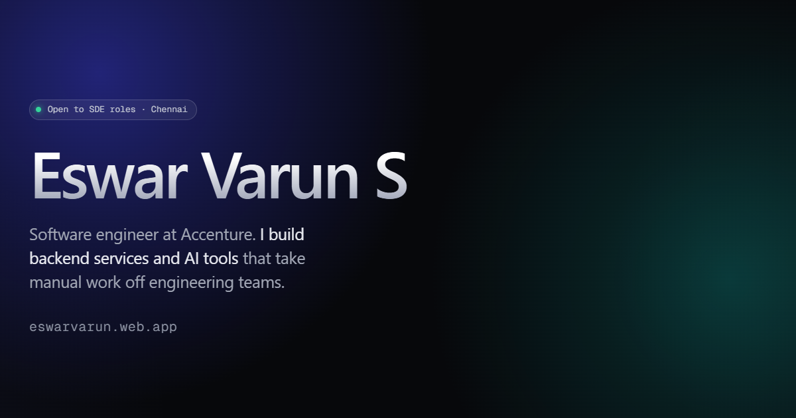

# eswarvarun.web.app

Personal site of **Eswar Varun S**, software engineer. Live at **https://eswarvarun.web.app**.



The site has two themes over the same content:

- **Aurora** (default): a dark product-site look: soft indigo and teal glows, a floating glass nav, project cards with a pointer spotlight that open into a glass detail panel, and live GitHub stats.
- **Editor**: an explorer with my projects as Markdown files, `experience.ts`, `skills.json`, a live `github.log`, tabs, and a terminal that takes commands (`help`, `ls`, `open <file>`, `theme`, `resume`, `email`).

Switch from the status-bar menu, the `theme aurora` terminal command, the "View as editor" link in Aurora's footer, or a link like [`?theme=ide`](https://eswarvarun.web.app/?theme=ide) or [`?theme=aurora`](https://eswarvarun.web.app/?theme=aurora). The choice is remembered per visitor.

## How it works

- **Content is data.** Everything on the site lives in [`src/data/profile.ts`](src/data/profile.ts) and both themes render from it, so adding a project is one object.
- **Themes are code-split.** [`src/themes.ts`](src/themes.ts) picks the theme (URL, then saved choice, then default) and each theme is a lazy chunk with its own CSS and fonts. Switching reloads into the new theme, so two themes' global styles never meet; an inline script in `index.html` sets the right background before any JS runs.
- **No syntax highlighter.** Each "file" is written as JSX lines built from small token components ([`src/editor/syntax.tsx`](src/editor/syntax.tsx)). Line numbers come from a CSS counter, and wrapped lines keep a hanging indent.
- **Live GitHub data.** `github.log` reads repos, languages and recent activity from the public GitHub REST API. Responses are cached in `sessionStorage` for 30 minutes to stay under the 60 requests/hour unauthenticated limit, one in-flight request is shared across the page, and the file shows a fallback if GitHub is unreachable.
- **Deep links.** The open file is kept in the URL hash, so `/#projects/dependency-tracker.md` opens that project directly.
- **Keyboard first.** <kbd>Ctrl</kbd>+<kbd>P</kbd> quick open, <kbd>Ctrl</kbd>+<kbd>`</kbd> terminal, <kbd>Ctrl</kbd>+<kbd>B</kbd> explorer; the terminal has history and Tab completion.
- **Works on phones.** The explorer becomes a drawer and the terminal opens on demand.

## Stack

React 18 · TypeScript · Vite · plain CSS · Firebase Hosting. About 60 KB of gzipped JS for either theme, no UI libraries.

## Run locally

```bash
npm install
npm run dev
```

## Deploy

```bash
npm run deploy   # type-check, build, firebase deploy --only hosting
```

## Structure

```
src/
  data/profile.ts     all site content
  themes.ts           theme registry, selection and switching
  editor/IdeApp.tsx   editor theme: title bar, explorer, tabs, panel, status bar
  editor/files.tsx    the files shown in the editor
  editor/syntax.tsx   token and line components
  editor/Terminal.tsx terminal commands, history, completion
  aurora/             aurora theme
  lib/github.ts       GitHub API client with caching
public/               favicon, social preview image, resume.pdf
```
